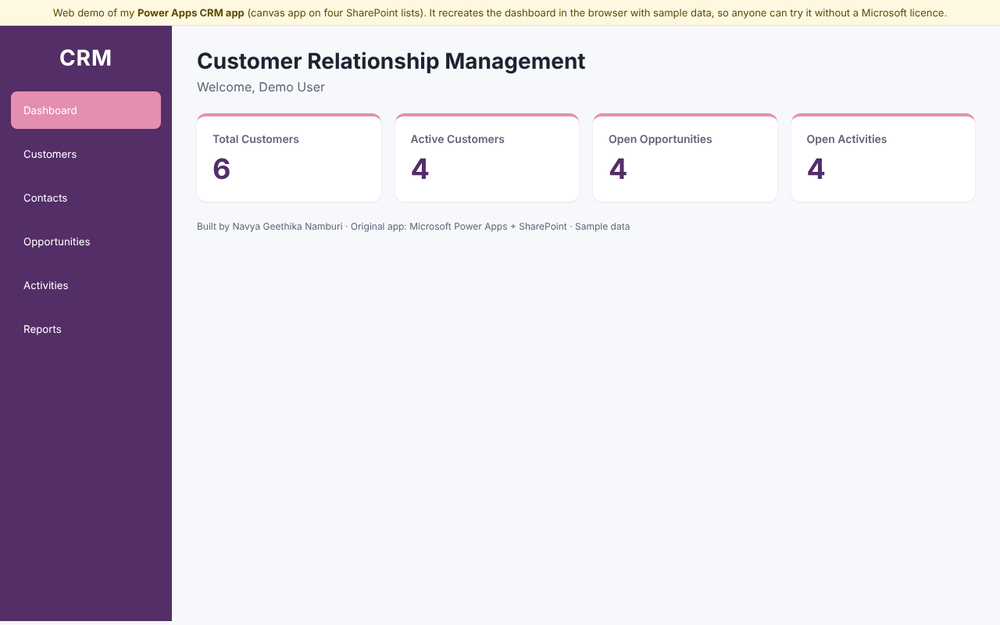
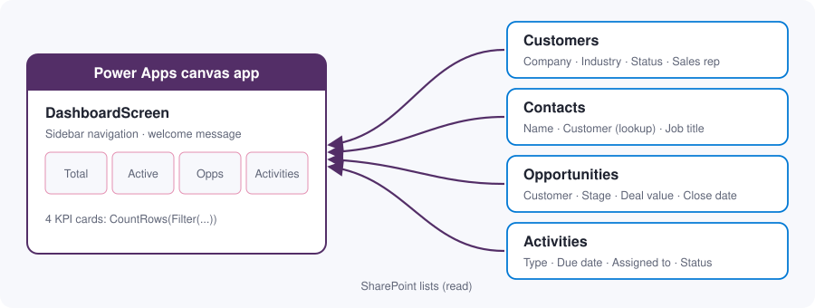
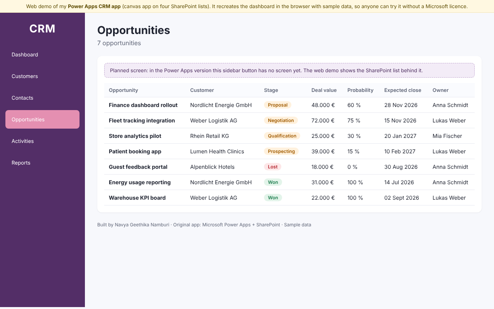

# CRM Dashboard App (Power Apps)

A Microsoft Power Apps canvas app that gives a sales team a quick overview of its customer relationship data. The dashboard reads four SharePoint lists (Customers, Contacts, Opportunities and Activities) and shows the key numbers at a glance.

   

### ▶️ [Try the live web demo](https://navya1223.github.io/CRM-Management-System/)

Power Apps needs a Microsoft 365 licence to run, so this repository also includes a **web version of the app**. It recreates the dashboard in plain HTML and JavaScript with sample data, so you can try it in any browser without a Microsoft account.

<p align="center">
  
</p>

## Table of Contents

- [Features](#features)
- [Architecture](#architecture)
- [Dashboard logic](#dashboard-logic)
- [Web demo](#web-demo)
- [Importing the app into Power Apps](#importing-the-app-into-power-apps)
- [Repository structure](#repository-structure)
- [Limitations and next steps](#limitations-and-next-steps)

## Features

- **Sidebar navigation** for Dashboard, Customers, Contacts, Opportunities, Activities and Reports
- **Personal welcome** using the signed-in user's name (`User().FullName`)
- **Four KPI cards** calculated live from SharePoint:
  - Total customers
  - Active customers
  - Open opportunities (every stage except Won and Lost)
  - Open activities
- **Responsive layout** built with Power Apps containers (auto-layout), so the dashboard adapts to different screen sizes

## Architecture

<p align="center">
  
</p>

| SharePoint list | Main columns |
| --- | --- |
| **Customers** | Company, Industry (choice), Status (choice), Website, Phone, Email, City, Country, Assigned Sales Rep (person), Notes |
| **Contacts** | Name, Customer (lookup), Job Title, Email, Phone |
| **Opportunities** | Title, Customer (lookup), Deal Value, Stage (choice), Expected Close Date, Probability, Owner (person), Notes |
| **Activities** | Title, Customer (lookup), Opportunity (lookup), Activity Type (choice), Due Date, Assigned to (person), Status (choice), Notes |

The lookup columns link contacts, opportunities and activities to their customer, which gives the CRM a small relational data model inside SharePoint.

## Dashboard logic

Each KPI card is a label whose `Text` property counts rows in a SharePoint list:

```powerfx
// Total Customers
CountRows(Customers)

// Active Customers
CountRows(Filter(Customers, Status.Value = "Active"))

// Open Opportunities
CountRows(Filter(Opportunities, Stage.Value <> "Won" && Stage.Value <> "Lost"))

// Open Activities
CountRows(Filter(Activities, Status.Value = "Open"))

// Welcome message
"Welcome, " & User().FullName
```

## Web demo

[`index.html`](index.html) is a single-file web version, published with GitHub Pages:

- The **dashboard** uses the same four KPI calculations as the Power Apps formulas, applied to sample data.
- The sidebar screens are **marked as planned**, because they don't exist in the Power Apps version yet. In the demo:
  - **Customers, Contacts, Opportunities and Activities** show the sample data from the matching SharePoint list.
  - **Reports** shows a simple pipeline overview: deal value by stage and key figures.

<p align="center">
  
</p>

## Importing the app into Power Apps

You need a Power Apps licence (the free [Power Apps Developer Plan](https://powerapps.microsoft.com/developerplan/) works) and a SharePoint site.

1. Create the four SharePoint lists with the columns listed in [Architecture](#architecture).
2. Go to [make.powerapps.com](https://make.powerapps.com) → **Apps** → **Import canvas app**, and upload [`power-apps/CRMManagementSystem_package.zip`](power-apps/CRMManagementSystem_package.zip).
3. During import, connect the SharePoint connection to your own site and lists.

The readable source of the app (Power Fx in YAML) is in [`power-apps/source`](power-apps/source).

## Repository structure

```
CRM-Management-System/
├── index.html                          # Web demo (GitHub Pages)
├── images/                             # Screenshots and architecture diagram
└── power-apps/
    ├── CRMManagementSystem_package.zip # Exported Power Apps package
    └── source/                         # Screen source code (Power Fx, .pa.yaml)
        ├── App.pa.yaml
        └── DashboardScreen.pa.yaml
```

## Limitations and next steps

This app is a **dashboard prototype**. Next steps:

- Build the **Customers, Contacts, Opportunities and Activities screens** (gallery, details and edit form) and connect them to the sidebar buttons with `Navigate()`
- Add a **Reports** screen with charts for the sales pipeline
- **Delegation:** `CountRows` on SharePoint is limited to the first 500 records by default (App Checker warns about this). For larger lists, use delegable alternatives or pre-aggregated values
- Add role-based views, for example showing each sales rep only their own customers
